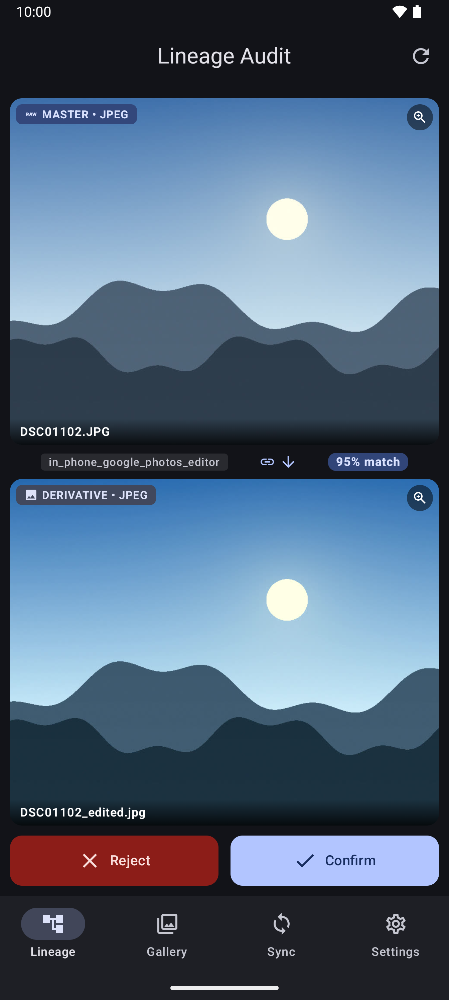
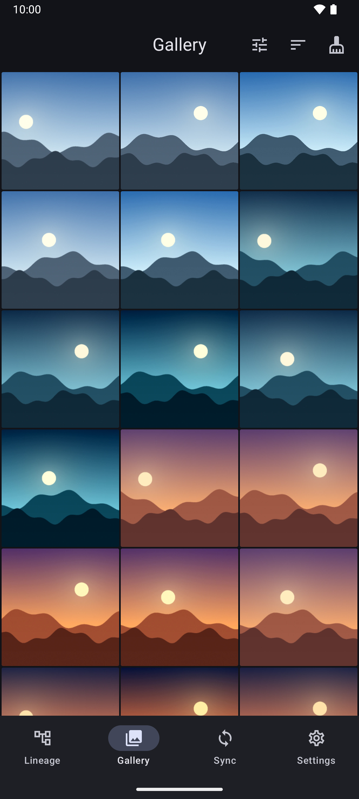
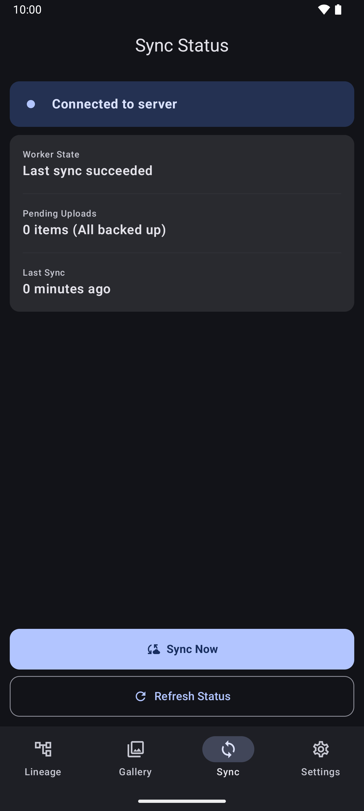

# branchdam-mobile

Native mobile companion application for [branchDAM](https://github.com/s3ntin3l8/branchdam), engineered for Android (optimized for Google Pixel Fold & flagships) and iOS.

<p align="center">
  
  
  
</p>

---

## Features

- **Automated Capture Ingest:** Background camera roll sync over Wi-Fi when charging via Android WorkManager and iOS BackgroundTasks.
- **Server-Governed Direct Streaming:** Uploads directly to `POST /api/v1/agent/upload` as one streamed HTTP body with a fixed `Content-Length` (not chunked transfer encoding), `X-Camera-Model` headers, and server-owned archive path resolution.
- **Dynamic Naming Template Sync:** Handshakes with the server to fetch and respect centralized naming templates (`{yyyy}/{yyyy}-{mm}-{dd}_{camera_model}/{original_name}`).
- **Lineage Pairing (Confidence 1.00):** Automatic pairing of computational RAW (DNG) + Ultra HDR JPEG assets and Motion Photos (legacy MicroVideo and the current Motion Photo container format). Weaker matches (capture-time proximity, in-phone edits) wait for the user's confirm or reject in the lineage review screen, and the decision is kept on the device.
- **Safe Space Reclaim:** Reclaims local device storage only after masters are durably archived and BLAKE3-verified on Tier 3 storage.
- **Bi-Directional Trash Sync:** System photo deletions propagate cleanly to Immich external libraries.
- **Foldable Dual-Pane UI:** Optimized for the Google Pixel 10 Pro Fold with swipe audit queue on cover screen and 8" lineage canvas.
- **USB-C OTG Field Ingest Hub:** Direct SD card reader ingest while traveling.

---

## Installation & Sideloading Guides

### Android Installation

#### Method A: Automated Updates via Obtainium (Recommended)
[Obtainium](https://github.com/ImranR98/Obtainium) tracks GitHub Releases directly and provides one-tap automated background updates.

1. Install [Obtainium](https://github.com/ImranR98/Obtainium) on your Android device.
2. In Obtainium, tap **Add App** (+).
3. Enter the repository URL:
   ```
   https://github.com/s3ntin3l8/branchdam-mobile
   ```
4. (Optional) Under Filter Regular Expression, enter `branchdam-mobile\.apk`.
5. Tap **Add**. Obtainium will automatically download the latest release `.apk` and notify you when new releases are published.

#### Method B: Direct Standalone APK Download
1. Navigate to the [Releases page](https://github.com/s3ntin3l8/branchdam-mobile/releases).
2. Download the latest `branchdam-mobile.apk` asset.
3. Open the downloaded APK on your device.
4. When prompted by Android, enable **Install unknown apps** for your browser or file manager, then tap **Install**.

#### Method C: Build from Source via Gradle
Prerequisites: JDK 21, Android SDK Platform 35, Android NDK (for native Go JNI library), and Go 1.25+.

```bash
# Clone repository
git clone https://github.com/s3ntin3l8/branchdam-mobile.git
cd branchdam-mobile

# 1. Build the gomobile-bound Go engine as an Android AAR
./scripts/build-mobile.sh --android-only
# Produces: android/app/libs/branchdam.aar (ABIs: arm64-v8a, x86_64)

# 2. Assemble release APK and App Bundle (AAB)
cd android
./gradlew assembleRelease bundleRelease

# 3. Install directly to connected device via adb
adb install -r app/build/outputs/apk/release/app-release.apk
```

The legacy CGO recipe (cross-compile `core/bindings` to `libbranchdamcore.so`) is no longer the supported build path. Use the gomobile flow above. The AAR is automatically wired into `android/app/build.gradle.kts` via a file-tree dependency, conditional on the file's presence so the project still builds before the AAR is produced (e.g. for unit-test runs on CI without NDK).

---

### Mobile Library Build (gomobile)

The branchdam engine ships as a single gomobile-bound Go package at the repository root (`branchdam.go`, package name `branchdam`). gomobile produces two artifacts from it:

| Target | Output | Consumer |
|---|---|---|
| Android | `android/app/libs/branchdam.aar` | Kotlin: `io.branchdam.core.Engine` |
| iOS | `ios/Frameworks/branchdam.xcframework` | Swift: `import branchdam` |

Both targets are uncommitted build artifacts generated on-demand by `./scripts/build-mobile.sh` or published as GitHub Release binaries.

#### Prebuilt Release Drop-In
To use the prebuilt iOS framework from a GitHub Release asset without building from source locally:
1. Download `branchdam.xcframework.zip` and `branchdam.xcframework.zip.sha256` from the release assets into the repository root.
2. From the repository root, verify the checksum:
   ```bash
   shasum -a 256 -c branchdam.xcframework.zip.sha256
   ```
3. Extract into `ios/Frameworks/`:
   ```bash
   unzip branchdam.xcframework.zip -d ios/Frameworks/
   ```

To build both at once:

```bash
make mobile-build
# or, individually:
make mobile-build-android   # AAR (requires ANDROID_HOME + ANDROID_NDK_HOME + javac)
make mobile-build-ios       # xcframework (requires macOS + Xcode)
```

`scripts/build-mobile.sh` is the single source of truth. It auto-installs `gomobile` + `gobind` into `$GOPATH/bin` on first run, asserts the required toolchain is available for the target you ask for, and prints the output path on success.

CI runs `make mobile-build` for the target platform as part of `ci.yml` (the `test-android` and `test-ios` jobs build the artifact before running the shell's unit tests). An optional `.github/workflows/mobile-bind.yml` workflow builds both targets and uploads the artifacts; opt in by adding the `mobile-bind` label to a PR.

---

### iOS Sideloading (Personal Apple ID)

The native iOS companion is structured for zero-configuration sideloading using Xcode with any free personal Apple ID.

#### Method A: Xcode Direct Sideloading (Free Apple ID)
1. **Prerequisites**: macOS with Xcode 16+ and an iPhone running iOS 17+.
2. **Clone & Build Core**:
   ```bash
   git clone https://github.com/s3ntin3l8/branchdam-mobile.git
   cd branchdam-mobile
   make mobile-build-ios   # Build the Go native core framework locally
   cd ios
   open BranchDamApp.xcodeproj
   ```
3. **Configure Signing**:
   - In the Xcode Project Navigator, select **BranchDamApp**.
   - Under the **Signing & Capabilities** tab, verify **Automatically manage signing** is enabled.
   - In the **Team** dropdown, select your personal Apple ID team (e.g. `Your Name (Personal Team)`). If you haven't added your Apple ID, click *Add Account...* and sign in with your standard Apple ID.
   - Set a unique Bundle Identifier if needed (e.g., `com.yourname.branchdam-mobile`).
4. **Build & Run**:
   - Connect your iPhone via USB or Wi-Fi.
   - Select your iPhone in the Scheme destination toolbar.
   - Press **Cmd + R** (or click the Play button) to build and deploy.
5. **Trust Developer Certificate on iPhone**:
   - On your iPhone, navigate to **Settings > General > VPN & Device Management**.
   - Tap your developer Apple ID under **Developer App**.
   - Tap **Trust "[Your Apple ID]"** and confirm.
   - Launch `branchDAM` from your home screen.

---

## Server Pairing & Configuration

### 1. QR Code Pairing
To pair the mobile app with your branchDAM server:
1. Open the branchDAM Web UI on your workstation.
2. Go to **Settings > Companion Pairing** and generate a Pairing QR code.
3. In the mobile app, tap **Scan Pairing QR** or point the camera at the code.
4. The QR code encodes a secure `branchdam://` payload:
   ```
   branchdam://?server=https://dam.example.com&key=<API_KEY>&agent=pixel-10-fold
   ```
   Release builds only accept an `https://` server URL (see below). Debug
   builds of the Android app also accept `http://` for the emulator loopback
   (`10.0.2.2`), `localhost`, `127.0.0.1` and `192.168.1.100`, and nothing
   else.

#### HTTPS on a home network
Both apps send the API key with every request, so they only talk to the server
over HTTPS (TLS 1.2 or newer). A release build refuses an `http://` server URL,
LAN addresses included: the Android network security config permits no
cleartext traffic, and the Go sync engine refuses `http://` itself on both
platforms. To run branchDAM on a LAN:

1. **Use a publicly trusted certificate (recommended, works on both
   platforms).** Give the server a DNS name you control, for example
   `dam.example.com`, and point it at the server's LAN address (a record in
   your router's or Pi-hole's local DNS is enough). Get a Let's Encrypt
   certificate for it with the **DNS-01** challenge, which does not need the
   server to be reachable from the internet. A reverse proxy such as Caddy or
   Traefik can do this for you and forward to branchDAM on `:8080`. On a
   Tailscale network, `tailscale cert` gives a trusted certificate for the
   machine's `*.ts.net` name the same way.
2. **Private CA or self-signed certificate:**
   - **iOS:** works. The engine verifies through the iOS trust store, so
     install your CA certificate as a profile, then turn it on under
     Settings > General > About > Certificate Trust Settings.
   - **Android:** not supported. The sync engine verifies against the
     system CA store only; it can't read CAs installed under Settings >
     Security > Encryption & credentials. Use option 1.
3. Pair with the `https://` address: the server URL inside the pairing QR is
   what the app connects to, so it must be the name on the certificate, not
   the bare IP.

Pinning the server's certificate through the pairing QR (which would let a
self-signed server work on Android) is not implemented.

#### API key storage
The API key is kept only in encrypted storage: the iOS Keychain, and on
Android `EncryptedSharedPreferences` backed by the Android Keystore. If the
Android Keystore is unavailable on a device, the app refuses to save the key
and says so on the Connection screen; it never falls back to storing the key
unencrypted, and it deletes a plaintext key an older release may have left
behind.

### 2. Ingest Architecture & Protocol
- **Handshake (`POST /api/v1/agent/handshake`)**:
  Exchanges device capabilities, checks protocol version, and receives the server's canonical naming template (e.g. `{yyyy}/{yyyy}-{mm}-{dd}_{camera_model}/{original_name}`).
- **Key rotation (branchDAM S13)**:
  When the server rotates this device's API key, the next handshake carries the new key sealed for the current one (`pendingRotation.sealedApiKey`: AES-256-GCM keyed by HMAC-SHA256 of the current key). The core opens it, has the shell store it (Android: the Keystore-backed `EncryptedSharedPreferences` `api_key` entry, written with `commit()`; iOS: the Keychain through `PairingCredentialStore.saveRotatedAPIKey`), and only then switches to it and adopts it with a second handshake, which revokes the old key on the server. If the shell cannot store it, the app stays on the old key. If the server refuses the new key on its first use, the core goes back to the old key, retries that request, and stores the old key again. `SyncBatch` handshakes when none succeeded in the last 6 hours, so a phone that only syncs in the background still picks a rotation up within the server's 24-hour grace window. A rotation the server cannot deliver (no `BRANCHDAM_SECRET_KEY` on the server) means pairing the device again by QR.
- **Direct Upload (`POST /api/v1/agent/upload`)**:
  Streams the file as one raw body with a fixed `Content-Length` and these headers:
  - `User-Agent`: Companion identifier (`branchdam-mobile/<agent_id>`).
  - `X-Filename`: Original camera roll file name.
  - `X-Camera-Model`: Hardware camera model string (e.g. `Google Pixel 10 Pro Fold`, `iPhone 16 Pro Max`).
  - `X-Blake3-Hash`: BLAKE3 checksum for integrity and archive verification.
  - `X-Source-Path-Hash`: SHA-256 of the item's local identifier (Android: the MediaStore content URI, `"$uri#$sizeBytes-$lastModifiedUnix"` for an OTG card file, and `"${contentUri}/microvideo"` for a motion photo's extracted video; iOS: the PHAsset `localIdentifier`); the upload route stores it for `GET /api/v1/agent/source-status` lookups (which take it as `?sourcePathHash=`).
  - `X-Fast-Hash`: Streaming fast hash (xxHash), sent for older servers; branchDAM's upload route ignores it (dedup runs on `X-Blake3-Hash`).
  - `X-Capture-Timestamp`: Capture time in Unix epoch seconds.
  - `X-API-Key`: Companion authentication credential (single header; `Authorization` is reserved for future short-lived bearer tokens and is not sent today — T2-6).
- **Lineage & Delete Events (`POST /api/v1/agent/events`)**:
  Shells queue events by the same local ID the media was enqueued for upload under (Android: the MediaStore content URI; iOS: the bare PHAsset `localIdentifier`). At sync time the core resolves local IDs to server node UUIDs and sends the server's own schema: `EVENT_EDGE_ATTACHED` as `{sourceNodeUuid (parent), targetNodeUuid (child), relationshipType, confidence, tier: 1, resolver}` once both items are uploaded (waiting edges expire after 30 days), and `EVENT_NODE_DELETED` as `{nodeUuid}`. Edges below confidence 0.50, unknown relationship types, and deletes for never-uploaded or reclaimed media are never sent. A 4xx answer other than 401/403/408/429 fails that event permanently; transport errors and 5xx are retried.
- **Safe Space Deletion Model**:
  Assets are only marked eligible for local deletion after `POST /api/v1/agent/node-status` reports the node as found, BLAKE3-verified, on `TIER3_MASTER_ARCHIVE`, live (`lifecycleState` `ACTIVE` or `HIDDEN`), and returns a `fullHash` equal (case-insensitively) to the BLAKE3 the app recorded for the item; a trashed, missing or archived master never authorises a reclaim, and neither does a node-status answer without a `fullHash` (`no-server-hash`), with a different one (`hash-mismatch`), or for an item with no local hash recorded (`no-local-hash`). node-status returns `fullHash` only from branchDAM #538 on, so with an older paired server every node answers `no-server-hash` and reclaim keeps every file (it fails closed). Last, the recorded hash speaks only for the bytes the item had at enqueue, so the reclaim itself re-verifies the local item immediately before the delete (#229, mirroring branchdam-agent's prune): the shell reads the item's current size and modification time (Android: MediaStore `SIZE` / `DATE_MODIFIED`; iOS: `PHAsset.modificationDate`, or `creationDate` when that is nil as it often is for never-edited originals (#232), PhotoKit has no public size) and the core keeps the file (`local-changed`) unless they equal the baseline recorded with the BLAKE3 at enqueue (`local_media_state.size_bytes` / `modified_unix`). An item with no baseline -- recorded before this check existed, or not a media-store item -- is kept too (`no-local-baseline`) until it is imported again. The Safe Space scan does not see the current state, so an item it lists can still be kept by the reclaim. Node-status lookups are sent in batches of at most 400 UUIDs (the server's per-request limit). A reclaim deletes only the phone copy and never emits a delete event for it.

---

## Development & Testing

Run all unit tests, linters, and secret detection:

```bash
make check
```

This runs:
- `pre-commit run --all-files` (detect-secrets, formatters, YAML/JSON checks)
- `go vet ./...` across core modules
- `go test -race -v ./...` with race detector enabled

### Screenshots

The images at the top of this README come from `make screenshots`
(`scripts/screenshots.sh`). It runs a headless emulator paired with a
throwaway branchDAM demo instance and uses synthetic media only. See
[CONTRIBUTING.md](CONTRIBUTING.md#regenerating-screenshots) for what it does
and what it needs.

---

## License

MIT
